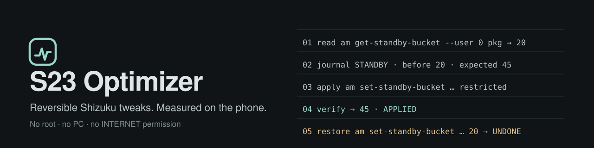
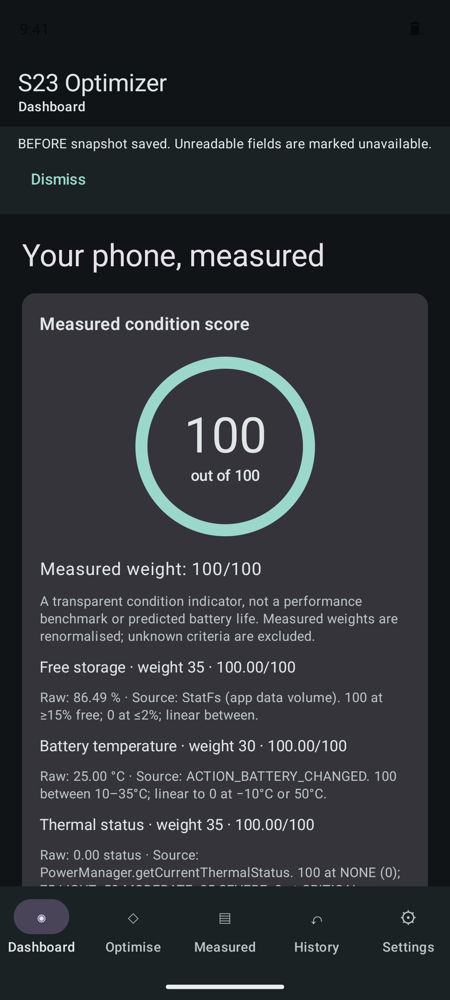
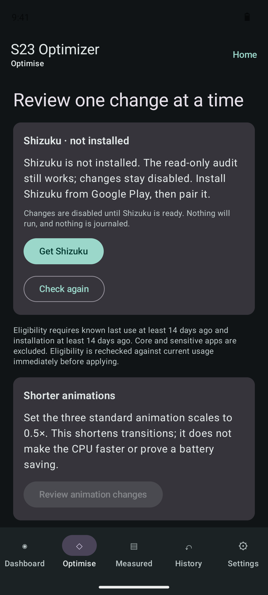
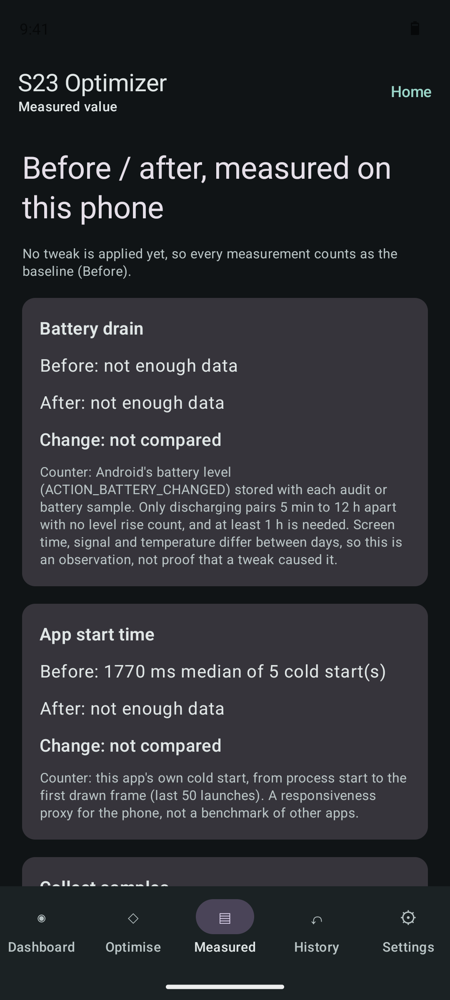
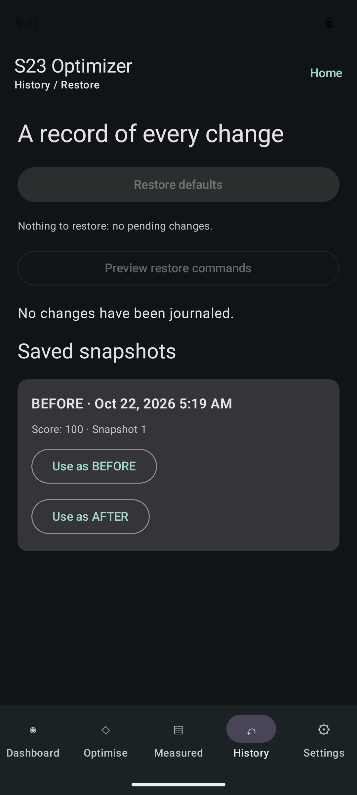
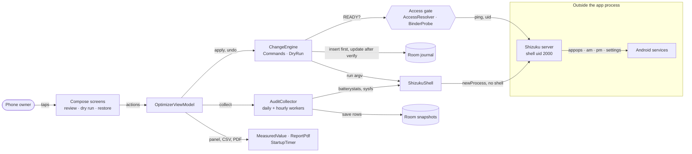

  

  
  
  
  
  
  
  
  

<b><a href="https://muhib-karim.github.io/s23-optimizer/">Homepage</a></b> · <a href="https://github.com/muhib-karim/s23-optimizer/releases/latest">Download</a> · <a href="https://muhib-karim.github.io/s23-optimizer/architecture.html">Architecture</a> · <a href="CHANGELOG.md">Changelog</a>

S23 Optimizer is an Android app that audits a Samsung Galaxy S23 Ultra (or any Android 10+ phone), applies a small set of **reviewed, journaled and reversible** tweaks through [Shizuku](https://shizuku.rikka.app/), and shows **before/after numbers measured on the phone**. No root, no PC, no INTERNET permission.

## Screenshots

Captured by GitHub Actions from the debug build on an Android 14 emulator (Pixel 7 profile, `.github/workflows/pages.yml`). The emulator has no Shizuku, so every change control shows its locked state and says why.

| Dashboard | Optimise (no Shizuku) | Measured | History / Restore |
|---|---|---|---|
|  |  |  |  |

More on the [homepage](https://muhib-karim.github.io/s23-optimizer/#screens): onboarding, audit details, Samsung settings.

## What it does

- **Audit (read-only).** Battery level, temperature and charge counter, storage, RAM, thermal status and headroom, CPU frequency samples, refresh rates, animation scales and the app inventory, each stored with its source. With Shizuku: per-UID drain estimates, wakelocks and alarms from `dumpsys batterystats --charged`, and every app's standby bucket.
- **Reviewed, reversible tweaks.** Four kinds only (table below). Each one reads the prior value, writes a journal row, runs one fixed argv, and verifies the result.
- **Dry run.** The confirm dialog lists the exact read, apply, verify and undo commands and copies them as text. Nothing runs until you tick the box and tap Apply.
- **One-tap Restore defaults.** Undoes every pending change newest first. *Preview restore commands* shows what it will run. A value you changed by hand since is left alone and stays pending.
- **Clear Shizuku states.** Not installed, not running, permission needed, permission denied and unsupported (root or secondary profile) each have their own message and button. Without access the engine refuses before any shell call or journal write; the audit still runs.
- **Measured before/after panel** with CSV export, plus the before/after PDF report from v1.0.0.

## Tweaks: what each does and how to undo it

Background and standby changes only reach **user-installed apps that were not used for 14 days and were installed at least 14 days ago**. Home launchers, keyboards, dialers, messaging, camera, alarms, maps/navigation, VPN, accessibility, device admins, banking/wallet/payment, Knox/security, Wear/SmartThings and Shizuku itself are never eligible.

| Tweak | What it does | Command (through Shizuku) | Undo (Restore defaults runs this) | Undo by hand |
|---|---|---|---|---|
| Background restriction | Stops an idle app running in the background. Notifications and sync may be delayed. | `cmd appops set --user 0 <pkg> RUN_ANY_IN_BACKGROUND ignore` | `cmd appops set --user 0 <pkg> RUN_ANY_IN_BACKGROUND <previous mode>` | Settings → Apps → app → Battery → Unrestricted/Optimised |
| Standby bucket | Moves an idle app to *rare* (40) or *restricted* (45), so its jobs and alarms run less often. | `am set-standby-bucket --user 0 <pkg> rare\|restricted` | `am set-standby-bucket --user 0 <pkg> <previous bucket>` | Open the app; Android promotes used apps again |
| Disable listed package | Disables one of seven named packages after you opt in: `com.samsung.android.bixby.agent`, `com.samsung.android.app.spage`, `com.samsung.android.arzone`, `com.samsung.android.game.gamehome`, `com.facebook.appmanager`, `com.facebook.services`, `com.facebook.system`. | `pm disable-user --user 0 <pkg>` | `pm enable --user 0 <pkg>`, then `pm default-state --user 0 <pkg>` if it was in its default state | Settings → Apps → filter *Disabled* → Enable |
| Shorter animations | Sets the three animation scales to 0.5×. Transitions get shorter; the CPU does not get faster. | `settings put global <window_animation_scale\|transition_animation_scale\|animator_duration_scale> 0.5` | `settings put global <key> <previous>`, or `settings delete global <key>` if it was unset | Developer options → animation scales → 1× |

Read-only commands the app may run: `dumpsys batterystats --charged`, `dumpsys package <pkg>`, `cmd appops get --user 0 <pkg> RUN_ANY_IN_BACKGROUND`, `am get-standby-bucket --user 0 [<pkg>]`, `settings get global <animation key>`, `cat <file under /sys/devices/system/cpu>`.

## What is measured, and what is not

| Measured on the phone | Not measured / not claimed |
|---|---|
| **Battery drain, %/h**: Android's battery level (`ACTION_BATTERY_CHANGED`) stored with each audit and, if you switch it on, an hourly battery sample. Only pairs that are both *Discharging*, 5 min–12 h apart and with no level rise count; at least 1 h is required. | A battery-life gain for your phone. Use, signal and temperature differ between days; the panel shows an observation, not a cause. |
| **App start time**: this app's own cold start, process start → first drawn frame, last 50 launches. | The launch speed of other apps. Cold start is a responsiveness proxy, not a benchmark. |
| **Before vs after** is split at the first tweak that is still applied; windows crossing it count on neither side. | Exact per-app energy. batterystats numbers are per-UID estimates that packages can share. |
| Audit readings with their source (see *What it does*). | Battery health %, private per-app storage, anything unreadable (shown as *unavailable*, never 0). |

Export the panel from **Measured → Export CSV**: summary rows plus every raw battery sample and cold start, each labelled `before` or `after`.

## Install (on the phone, with Shizuku)

1. Open [Releases](https://github.com/muhib-karim/s23-optimizer/releases/latest) on the phone and download `S23-Optimizer-vX.Y.Z.apk` (its `.sha256` is next to it).
2. Allow *Install unknown apps* for your browser when Android asks, then install.
3. Open S23 Optimizer and grant **Usage access** when asked (needed for idle evidence and foreground time).
4. Install **Shizuku** from Google Play (the app's *Get Shizuku* button opens it).
5. Settings → About phone → Software information: tap **Build number** seven times to enable Developer options.
6. Settings → Developer options: turn on **Wireless debugging** (Wi-Fi must be on).
7. In Shizuku tap **Pairing**; in Wireless debugging tap **Pair device with pairing code**, and enter the code in Shizuku's notification.
8. In Shizuku tap **Start**. Back in S23 Optimizer tap **Grant Shizuku permission**. The status panel turns to *ready*.

After a reboot, turn Wireless debugging on and tap Start in Shizuku again (pairing is remembered).

## Architecture

`core/` is pure Kotlin with no Android imports and holds every decision: command building, the journal-first engine, the access gate and the measurements. `platform/` adapts Android and Shizuku to small interfaces; `ui/` renders state. An [interactive, source-linked version](https://muhib-karim.github.io/s23-optimizer/architecture.html) is on the homepage.

| Path | Responsibility |
|---|---|
| `core/ChangeEngine.kt` | Access gate → eligibility → read prior → journal row → mutate → verify; undo/restore with conflict detection |
| `core/Commands.kt`, `core/DryRun.kt` | Exact argv for read/apply/undo; dry-run listing for apply and restore |
| `core/Access.kt` | Shizuku state machine (`ShizukuProbe` → `ShellAccess` with message and action) |
| `core/Measured.kt` | `DrainMeter`, `MeasuredValue` (before/after split, CSV), `StartLog` |
| `core/Eligibility.kt`, `Parsers.kt`, `Scoring.kt`, `ReportDiff.kt` | Idle evidence and allowlist, strict shell/batterystats parsing, condition score, report diff |
| `platform/` | Shizuku binder and shell, audit collector, workers, startup timer, PDF, Samsung settings links |
| `data/` | Room journal and snapshots (schema v1, unchanged since 1.0.0) |

## Tests and coverage

- **Pure JVM tests** (`app/src/test/.../core`): exact argv for every command, every optimizer action end to end against a modelled device (`DeviceShell`: appops, standby, pm, settings), conflicts, restore order, dry run, all six access states and the engine gate, drain/start-time maths and CSV, parsers, eligibility, scoring.
- **Robolectric UI smoke test** (`ui/AppSmokeTest.kt`): launches `MainActivity` with no Shizuku and walks onboarding → dashboard → Optimise (locked) → History (Restore disabled) → Measured.
- **Coverage**: Kover XML/HTML in every CI run (artifact `test-and-coverage-reports`, table in the job summary). On the first v1.1.0 run: 71 tests, `core` 98.7 % lines, whole app 47.2 % lines (Android adapters are exercised on devices, not on the JVM).

## CI on GitHub Actions

| Workflow | Gate |
|---|---|
| `ci.yml` | ktlint 1.5.0 and detekt 1.23.8 (pinned by SHA-256), unit + Robolectric tests with Kover, debug and unsigned release APKs |
| `codeql.yml` | CodeQL `java-kotlin`, security-and-quality queries |
| `gitleaks.yml` | Secret scan of full history and working tree |
| `pages.yml` | Emulator screenshots → homepage deploy |
| `release.yml` | On a `vMAJOR.MINOR.PATCH` tag: tests, signed `assembleRelease` from repository secrets, APK + SHA-256 attached to the GitHub Release |
| Dependabot | Weekly Gradle and Actions updates |

Builds and tests run only on Actions. Locally you need JDK 17 and Android SDK 35, then `gradle testDebugUnitTest assembleDebug`. Lint without Gradle: `ktlint "app/src/**/*.kt"` and `detekt-cli --build-upon-default-config --config config/detekt/detekt.yml --input app/src`.

## FAQ

**Does it need root?** No. Shizuku runs commands as the shell user (uid 2000) through Wireless debugging. Root mode is deliberately unsupported.

**What happens without Shizuku?** The audit still runs with less detail; every change button stays disabled with the reason and the next step (get, open, grant).

**Can a tweak break my phone?** The list is four tweaks with exact undos, sensitive app categories are excluded, and disabling is limited to seven named packages behind an opt-in. Restore defaults puts back every journaled value.

**What if I changed a setting myself after the app did?** Restore sees a value that is neither the saved nor the requested one, leaves it untouched and keeps the record pending.

**I rebooted and Shizuku stopped.** Expected: Wireless debugging turns off on reboot. Turn it on and tap Start in Shizuku.

**Will uninstalling undo the tweaks?** No. Uninstalling or clearing data removes the journal while the Android settings stay changed. Tap Restore defaults first.

**Why does the battery panel say "not enough data"?** It needs at least one hour of discharging windows on each side of your first tweak. Switch on hourly battery samples or take audits while unplugged.

**Does it send data anywhere?** No. It has no INTERNET permission and no analytics, and Android backup is off. PDF and CSV leave the phone only when you save or share them.

**Is it Samsung-only?** It targets the S23 Ultra on One UI 6/7 and runs on any Android 10+ phone; the Samsung settings shortcuts fall back to generic Settings.

## Licence

Apache License 2.0, see [LICENSE](LICENSE). Not affiliated with Samsung or Shizuku. Site fonts: Archivo and IBM Plex under the SIL Open Font License (`site/fonts/OFL.txt`).
